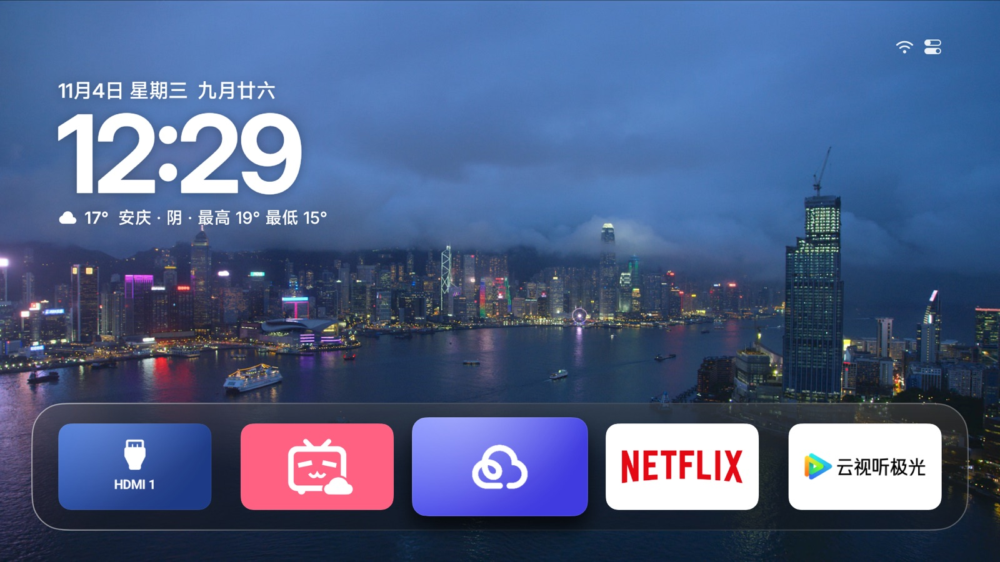

<div align="center">


# Aerial · Xiaomi TV fork

A launcher tuned for one TV: the Xiaomi TV S65 Mini LED (MiTV-MFTR0). Forked from [Aerial](https://github.com/pengchujin/aerial-tv).

<a href="https://github.com/le5inioo/aerial-mitv-mftr0/releases/latest"></a>
<a href="https://github.com/le5inioo/aerial-mitv-mftr0/releases/latest"></a>
<a href="LICENSE"></a>




</div>

[中文](README.md) · English

## Upstream

This is a fork of [pengchujin/aerial-tv](https://github.com/pengchujin/aerial-tv) — an Apple TV–style Android TV launcher without ads or recommendation feeds. Features, installation for other brands, supported devices and the adaptation workflow all live there; this repository does not repeat them.

Two things only: **what this TV is**, and **what changed**. Still MIT, upstream attribution in [NOTICE.md](NOTICE.md).

## The TV

Everything was measured on this one unit, read straight off the device on 2026-11-05.

| Item | Value |
|---|---|
| Brand / model | Xiaomi MiTV-MFTR0 |
| Retail name | Xiaomi TV S65 Mini LED 臻享版 (L65MA-SPL) |
| CPU | mt5879 · armeabi-v7a · 4 cores |
| RAM | 3.7 GB usable (`MemTotal: 3,860,504 kB`, 4 GB nominal) |
| OS | Android 11 (SDK 30) |
| Firmware | HyperOS 2.0.5.0 (`OS2.0.5.0.RFTMATV`) |

Apps only ever see 1080p, so budget layout and frame time against that: the system exposes 1920×1080 in a single 60 Hz mode, and the panel's real resolution is not readable from properties — do not plan for the nominal 4K.

## What changed

Against upstream `main` as of 2026-11-05: 28 commits, 210 files, +2898 / −16899 lines — more deleted than added, because upstream's `lite/`, the `site/` website, the other device notes and the generic installer are gone. What is left falls into four parts.

### 1. Making it the home screen

| Change | Where | Why |
|---|---|---|
| Package renamed to `com.ts.launcher` | `applicationId` in `app/build.gradle.kts` | The firmware only hands HOME to packages on its own whitelist (`MitvSettings.isThirdPartyHomeAllowed` → `isAppInWhitelistWithFlag(pkg, 4)`; the list is cloud-delivered and unreadable by shell). `com.ts.launcher` is on it, `app.orchard.tv` is not. Components still live in the `app.orchard.tv` namespace — deliberate |
| PatchWall disabled | `tools/install-ts.sh` (`DISABLE_STOCK_HOME=1`) | The package name alone is not enough: while PatchWall is alive, HOME resolves to a chooser (`addPreferredActivity: Don't set 3-app default home`). Disabled, HOME resolves straight to Aerial, no flash of the stock launcher |
| Home guard | `guard/HomeGuardService.kt` | Switches back whenever the stock launcher comes to the front; a notification listener revives it after standby kills it; boot, wake and revival all wait 1.5 s before taking over, so a CEC source switch is not covered up |
| Conditional key filtering | `guard/HomeGuardService.filterKeys` | Intercepts HOME before the system while Aerial is in front (no flash); not in other apps — filtering everywhere made third-party apps move focus two steps per press. Injected `input keyevent` bypasses it |
| Developer mode and ADB kept on | `guard/GuardSetup.kt` | On boot, writes back `development_settings_enabled`, `developer_status` (Xiaomi private key) and `adb_enabled`, then watches them with a `ContentObserver`. State is mirrored to device-protected storage so it survives the pre-unlock window. Standby resets `adb_enabled` to 0; without this ADB is gone for good |
| 10-minute PIN grace | `ui/home/PinPad.kt` | One correct PIN covers the next 10 minutes, so leaving Kids mode does not re-prompt on every settings page |

### 2. Getting back from a broken state

| Script | What it does |
|---|---|
| `tools/rescue.sh` / `tools/rescue.bat` | Black-screen recovery in one command: connect → diagnose → re-enable PatchWall → hand HOME back → wake the panel. `--scan` searches the subnet, `--check` only diagnoses. `rescue.bat` runs it on a double-click in Windows |
| `tools/restore.sh` | Restores the stock launcher: `pm enable` **first**, then hand HOME over — the other order leaves no Home for a second and the screen goes black. `PKG=` overrides the package |
| `tools/install-ts.sh` | Installs `com.ts.launcher`, sets it as HOME, optionally disables PatchWall; `KEEP_ADB=1` reopens ADB when the TV closes it, `BUILD=1` builds first |
| `tools/dev-mode.sh` | Opens developer mode and ADB once |
| `tools/test_rescue.py`, `tools/test_restore.py` | Stub-adb tests for the two scripts above |

**Never disable `com.mitv.tvhome` unless a whitelisted launcher is installed and verified.** With no whitelisted HOME, HOME falls to `FallbackHome`, which refuses third-party launchers too: the TV boots to a black screen logging `User unlocked but no home`. Measured the hard way.

### 3. Launcher features added

| Feature | What it does | Where |
|---|---|---|
| **One wallpaper per tile** | Each tile in the top row gets its own wallpaper, swapped as focus moves; stored by slot index so it survives app changes; builtin, phone-uploaded photo or video, Bing daily, or "inherit" | Personalize → Wallpaper → per tile |
| **Video wallpapers** | Phone-uploaded videos as wallpaper: muted, looping, one after another; a key press freezes the current frame and playback resumes from it | same |
| **LAN image-host wallpaper** | Fetches a fresh image from a local image host every time Home comes back; address editable on the phone page | Personalize → Wallpaper |
| **Playback speed** | 0.5×–1.5× in 0.1 steps for video wallpapers and the screensaver, left/right to change | Personalize → Wallpaper / Screensaver |
| **Fade between wallpapers** | Every wallpaper switch is a 650 ms dissolve instead of a hard cut | automatic |
| **Wake splash** | 5 s spinner when waking from standby, then fades into Home; nothing on cold starts or restarts (the firmware's own boot animation covers those) | Personalize → TV System → Wake animation |
| **Single-video screensaver** | Pick one specific video in a second-level picker | Personalize → Screensaver |
| **Auto-brightness fix** | Fixes the dead brightness slider under Xiaomi's auto-brightness; shows a hint instead of forcing the slider where unsupported | Control Center → Brightness |
| **Developer mode at boot** | Reopens developer options and ADB after every boot (Xiaomi closes them now and then) | Personalize → TV System |
| **Five languages** | zh, en, ru, uk, kk — new strings included | — |

Three of them are worth explaining:

**The wake splash.** Standby `forceStopPackage`s every third-party app on this firmware (`MitvActivityManagerService.killAllThirdApp`), so a wake is a cold start: Home's first composition plus the video-wallpaper decoder hold the main thread — `Skipped 49 frames` in the log, the spinner jerking. So the splash **wraps** Home instead of sitting over it: four seconds of spinner alone (nothing else composes, zero dropped frames measured), the spinner eases out, Home composes behind it, and the fade starts once Home has laid out — about 4.9 s panel to desktop. Triggered in `onResume` (the `SCREEN_ON` broadcast lands ~2 s after the panel lights, too late), once per screen-off (armed when the screen goes off; the firmware sends no `SCREEN_OFF` broadcast, so `onStop` with the panel dark arms it).

**Upstream's boot animation removed.** It showed "a few frames" here: cold power-on, `adb reboot` and the power menu's restart all start Home 13 s in, with the firmware's animation on top from 7.3 s to 14.9–17.1 s — Aerial's played underneath and only its tail was visible. Telling the cases apart is impossible: `ro.boot.bootreason` is SELinux-blocked for apps (empty string, no exception), `sys.boot.reason` lands after `BOOT_COMPLETED`, and the timings are identical. Dropped it.

**Speed slider contrast.** Focused, the accent and the thumb were both white; the fill now inverts against the background.

**Hand-made tile art.** [docs/tile-icons/](docs/tile-icons/) carries 69 hand-made 16:9 tile pictures (640×360 PNG): Bilibili, iQIYI, Youku, Mango, Migu, YouTube, Netflix, Emby, Kodi and more, most apps in several color variants. Upload one from the phone page to use it on a tile; file names name the apps, and the [preview sheet](docs/tile-icons/preview.jpg) shows everything at a glance.

## Install

The TV needs ADB on (Settings → About → press the model row repeatedly, then Settings → Account & Security → ADB debugging), and must be on the same network as the computer.

```bash
git clone https://github.com/le5inioo/aerial-mitv-mftr0.git
cd aerial-mitv-mftr0
TV=<TV-IP> BUILD=1 KEEP_ADB=1 DISABLE_STOCK_HOME=1 tools/install-ts.sh
```

Or grab `ts-launcher-1.84-web19.apk` from [Releases](https://github.com/le5inioo/aerial-mitv-mftr0/releases/latest) and pass `APK_FILE=`.

`DISABLE_STOCK_HOME=1` disables `com.mitv.tvhome`. That buys an instant, flash-free Home key and costs a black screen if Aerial ever breaks — keep `tools/rescue.sh` at hand and ADB open. Without it the guard fights PatchWall for the Home key instead (brief flash). Upgrades are the same command; settings survive (`versionCode` counts up from 1000).

## Black screen

A black screen means nothing owns HOME: the stock launcher was disabled and the replacement is gone. The remote's Home key does nothing and settings are unreachable — ADB is the only way in.

```bash
tools/rescue.sh              # the default address
tools/rescue.sh <TV-IP>
tools/rescue.sh --scan       # find a TV with ADB open on this subnet
tools/rescue.sh --check      # diagnose only, change nothing
```

On Windows, double-click `tools/rescue.bat`. Exit status 0 means HOME resolves again. To go back to the stock launcher: `TV=<TV-IP> tools/restore.sh` (add `--uninstall` to remove Aerial as well).

## Known limits

- **ADB dies in standby** — Wi-Fi goes off, and remote wake (WoL, Mi Home) cannot bring it back. Standby behaviour can only be tested with the physical remote; injected `keyevent 26` does not survive standby.
- **Injected keys skip the accessibility filter** — testing "Home key returns to Aerial from the stock launcher" needs the real remote.
- **PatchWall shows for a moment after a wake** — the process was killed during standby, so nothing can take over early. Boot reaches Aerial 6.7–9.9 s after the panel lights.
- **Do not disable `com.mitv.tvhome`** unless a whitelisted launcher is installed and verified.
- **Source switching** was only verified against the 8 inputs of this unit.

## Reading the logs

Diagnostics go to the `AerialDiag` tag (`system/DiagLog.kt`):

```bash
adb connect <TV-IP>:5555
adb logcat -d -s AerialDiag:* | tail -30
adb shell getprop ro.build.version.sdk
adb shell dumpsys window | grep mCurrentFocus
adb shell dumpsys accessibility | grep -i filter
```

Every measurement, dead end and reason — the whitelist mechanism, standby killing processes, CEC stealing the input, the FallbackHome black screen — is in [docs/devices/xiaomi-mitv-mftr0.md](docs/devices/xiaomi-mitv-mftr0.md) (Chinese, far more detailed than this file). It is a dated log, and some entries were written on another firmware generation (`OS3.0.10x` / Android 14); the version numbers there follow whatever `getprop` reported at the time, and the top of that file says so.

## Building

JDK 17 and Android SDK 36.

```bash
./gradlew assembleStandardRelease
BUILD=1 KEEP_ADB=1 TV=<TV-IP> tools/install-ts.sh
python tools/test_rescue.py && python tools/test_restore.py
```

See [docs/ARCHITECTURE.md](docs/ARCHITECTURE.md) for structure and performance constraints, [docs/HANDOFF.md](docs/HANDOFF.md) for handover notes.

`versionName` follows upstream (`1.84`); `versionCode` runs on its own four-digit line (`1095`, counting up from 1000) so the two never collide.

"Check for updates" avoids `api.github.com` — 60 requests an hour per IP is easy to spend, and the TV hit a 403 there on 2026-11-05. It requests `github.com/le5inioo/aerial-mitv-mftr0/releases/latest` instead, follows the 302 to `/releases/tag/v1.85-web1`, and takes the tag off the landing URL as the version (`v1.85-web1` → `1.85`). The APK always comes from `.../releases/latest/download/ts-launcher.apk`. A release must therefore carry a tag matching `versionName` (bumping only the webNN counter will not prompt the TV), and the APK must be uploaded a second time under the name `ts-launcher.apk`. The repo has a single module now (`app`); upstream's `lite/`, `site/` and the other device notes are gone, so `./gradlew` only builds the full app.

## License

[MIT](LICENSE). Upstream copyright belongs to the [pengchujin/aerial-tv](https://github.com/pengchujin/aerial-tv) authors — see [NOTICE.md](NOTICE.md). Inter is under the [SIL Open Font License](FONT-LICENSE-OFL.txt); weather city data from [GeoNames](https://www.geonames.org) (CC BY 4.0), weather from [Open-Meteo](https://open-meteo.com); aerial films belong to Apple and stream from Apple's servers.
