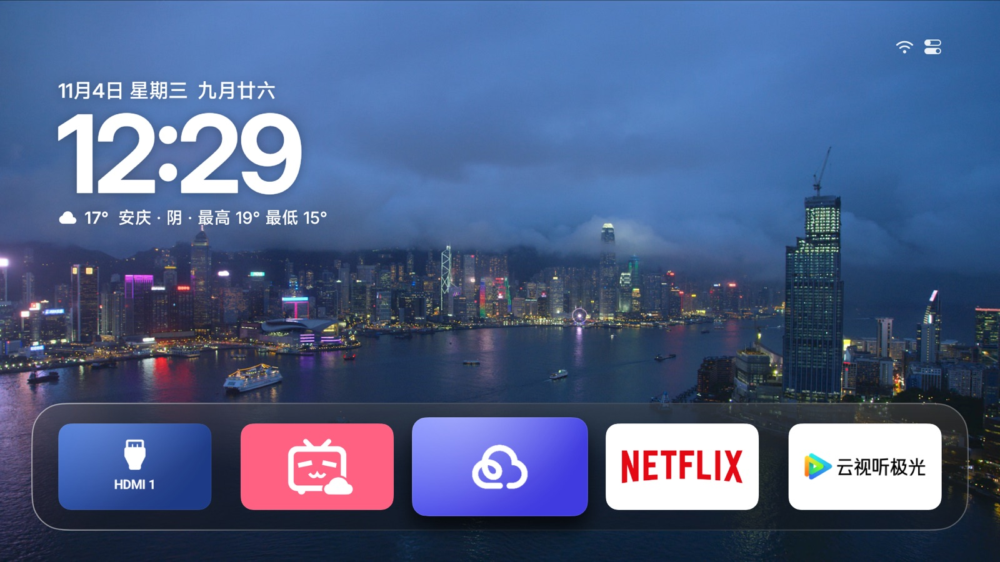

<div align="center">


# Aerial · 小米电视定制分支

给一台小米电视 S65 Mini LED（MiTV-MFTR0）改的桌面，从 [Aerial](https://github.com/pengchujin/aerial-tv) 分出来。

<a href="https://github.com/le5inioo/aerial-mitv-mftr0/releases/latest"></a>
<a href="https://github.com/le5inioo/aerial-mitv-mftr0/releases/latest"></a>
<a href="LICENSE"></a>




</div>

## 上游

上游是 [pengchujin/aerial-tv](https://github.com/pengchujin/aerial-tv)：一个参照 Apple TV 做的 Android TV 桌面，没有广告和推荐流。功能、安装方式、支持的机型、适配流程都在那边，本仓库不再重复。

这里只记两件事：**这台电视是什么**，以及**相对上游改了哪里**。代码仍是 MIT，上游归属见 [NOTICE.md](NOTICE.md)。

## 这台电视

调试和实测都在这一台上做，型号和固件跟着系统更新会变，下面这份是 2026-11-05 从设备上直接读出来的。

| 项目 | 值 |
|---|---|
| 品牌 / 型号 | 小米（Xiaomi）MiTV-MFTR0 |
| 零售型号 | 小米电视 S65 Mini LED 臻享版（L65MA-SPL） |
| CPU | mt5879 · armeabi-v7a · 4 核心 |
| 内存 | 3.7 GB 可用（`MemTotal: 3,860,504 kB`，标称 4 GB） |
| 系统 | Android 11（SDK 30） |
| 固件 | HyperOS 2.0.5.0（`OS2.0.5.0.RFTMATV`） |

应用层只有 1080p，写布局、算帧预算都按这个来：系统给的是 1920×1080、单一 60 Hz 模式，面板物理分辨率从属性里读不到（只有 `ro.boot.panel_type=lcd`），不要按标称 4K 估。

## 本分支做了什么

相对上游 `main` 分支：26 个提交、210 个文件、+2893 / −16896 行。删掉的多于新增的，因为上游的 `lite/`、官网 `site/`、其它机型笔记和通用安装脚本都清掉了。剩下的分四块。

### 一、让它能当桌面

| 改动 | 位置 | 为什么 |
|---|---|---|
| 包名换成 `com.ts.launcher` | `app/build.gradle.kts` 的 `applicationId` | 固件只把 HOME 交给白名单里的包名（`MitvSettings.isThirdPartyHomeAllowed` → `isAppInWhitelistWithFlag(pkg, 4)`，白名单云控下发、shell 读不到）。`com.ts.launcher` 在白名单里，`app.orchard.tv` 不在。代码里的组件仍是 `app.orchard.tv` 命名空间，两者不一致是刻意的 |
| 停用 PatchWall | `tools/install-ts.sh`（`DISABLE_STOCK_HOME=1`） | 只改包名不够：PatchWall 还活着时 HOME 会解析成桌面选择框（`addPreferredActivity: Don't set 3-app default home`）。停用后 HOME 直接解析到 Aerial，按主页键不闪原桌面 |
| 桌面守护 | `guard/HomeGuardService.kt` | 原桌面一到前台就切回来；待机被杀后靠通知监听复活；开机、亮屏、复活三种情况都等 1.5 秒再接管，免得盖掉 CEC 正在切的信号源 |
| 条件按键过滤 | `guard/HomeGuardService.filterKeys` | Aerial 自己在前面时在系统之前拦主页键，省掉「闪一下小米桌面」；在别的 App 里不拦（1.11 之前一直拦，第三方 App 里按键变成移动两格） |
| 守住开发者模式与 ADB | `guard/GuardSetup.kt` | 开机把 `development_settings_enabled`、`developer_status`（小米私有键）、`adb_enabled` 写回，之后 `ContentObserver` 盯着，被关掉几秒内补上；状态同时镜像到设备加密存储，解锁前的空窗期也能补回来。小米待机后会把 `adb_enabled` 改成 0，没这个就再也连不上 |
| 家长密码 10 分钟宽限 | `ui/home/PinPad.kt` | 输对一次密码后 10 分钟内进系统设置不再重复要密码（退出儿童模式那一下最烦） |

### 二、出事了能回来

| 脚本 | 用途 |
|---|---|
| `tools/rescue.sh` / `tools/rescue.bat` | 黑屏应急，一条命令：连接 → 诊断 → 启用被停用的 PatchWall → 交还 HOME → 唤醒电视。`--scan` 扫网段找电视，`--check` 只看诊断不改动。Windows 双击 `rescue.bat` 即可 |
| `tools/restore.sh` | 还原：先 `pm enable` 原桌面，**再**把 HOME 交回去，顺序反了中间那一秒没有 Home、会停在黑屏。`PKG=` 可覆盖包名 |
| `tools/install-ts.sh` | 安装 `com.ts.launcher`、设成 HOME、按需停用 PatchWall；`KEEP_ADB=1` 在电视关掉 ADB 后自动打开，`BUILD=1` 先编译 |
| `tools/dev-mode.sh` | 单独把开发者模式和 ADB 打开一次 |
| `tools/test_rescue.py`、`tools/test_restore.py` | 上面两个脚本的桩测试（假 adb），改脚本前后跑一遍 |

**顺序是硬约束**：没有白名单包名的桌面可接管时，千万不要停用 `com.mitv.tvhome` —— HOME 会落到 `FallbackHome`，而它也不认第三方桌面，结果是开机一直黑屏刷 `User unlocked but no home`。实测踩过，`pm enable` 才救回来。

### 三、桌面本身加的功能

| 功能 | 说明 | 入口 |
|---|---|---|
| **每块磁贴一张壁纸** | 第一排每个磁贴各配一张壁纸，焦点移到哪个背景就换哪张；按序号记住，换 App 也保留；可以选内置图、手机传的照片或视频、每日一图、或者「跟随默认」 | 个性化 → 壁纸 → 每块磁贴 |
| **视频壁纸** | 手机传的视频当壁纸，静音、循环、一个接一个；按键时停在当前帧，下次从这一帧接着播 | 同上 |
| **局域网图床壁纸** | 每次回桌面从局域网图床取一张新图，地址可在手机页改 | 个性化 → 壁纸 |
| **播放倍速** | 视频当壁纸或屏保时的速度，**0.5–1.5 倍，每 0.1 一档**，按左右键调 | 个性化 → 壁纸 / 屏保 |
| **壁纸淡入淡出** | 所有壁纸切换改成 650 ms 溶解过渡，原来是硬切 | 自动 |
| **唤醒动画** | 待机唤醒时播 5 秒转圈动画再淡入桌面；冷启动和重启不播（系统自己的开机动画占满了） | 个性化 → 电视系统 → 唤醒动画 |
| **屏保单视频** | 屏保可以指定某一个视频，二级选择器里挑 | 个性化 → 屏保 |
| **自动感光亮度** | 修小米自动感光下亮度条没反应；不支持时改成提示而不是强推滑块 | 控制中心 → 亮度 |
| **开机开启开发者模式** | 每次开机自动把开发者选项和 ADB 重新打开（小米偶尔自己关掉） | 个性化 → 电视系统 |
| **五语言** | 中文、英文、俄语、乌克兰语、哈萨克语，新增文案都补齐了 | — |

三个功能值得说一下怎么做的：

**唤醒动画**。这台电视待机时固件会 `forceStopPackage` 掉所有第三方 App（`MitvActivityManagerService.killAllThirdApp`），所以每次唤醒其实是一次冷启动：桌面首次组合加上视频壁纸解码器初始化会占住主线程，日志里是连续的 `Skipped 49 frames`。所以动画不是盖在桌面上，而是**包住**桌面：前 4 秒只画 spinner（其余什么都不组合，实测零掉帧）→ spinner 淡出 → 这时才在动画后面组合桌面 → 桌面布局完成后再 0.7 秒淡出，总共约 4.9 秒。触发时机在 `onResume`（`SCREEN_ON` 广播实测比亮屏晚约 2 秒，等它就晚了），一次熄屏只播一次（屏幕熄灭时记账，`onStop` + 屏幕不亮兜底，因为这个固件不发 `SCREEN_OFF` 广播）。

**移除上游的开机动画**。上游自带一个 Aerial 开机动画，在这台机器上表现为「闪几帧就消失」：实测冷开机、adb 重启、遥控菜单重启三种方式完全一样——桌面都在开机 13 秒启动，系统自己的开机动画 7.3 秒起播、14.9–17.1 秒退场，Aerial 的动画全程被压在系统动画底下。想按开机原因区分也做不到：`ro.boot.bootreason` 被 SELinux 拦（`bootloader_boot_reason_prop`，应用读到空字符串且不抛异常），`sys.boot.reason` 在 `BOOT_COMPLETED` 之后才写入，三种开机的时长又没有差别。所以直接去掉了，系统动画结束就进桌面。

**倍速滑块的对比度**。滑块聚焦时强调色和滑块都是白色，看不见档位；改成填充色随底色反转，聚焦时用深色填充。

## 安装

前提：电视开了 ADB（设置 → 关于 → 连续按「产品型号」进开发者模式，再到 设置 → 账号与安全 打开「ADB 调试」），电脑和电视同一网段。

```bash
git clone https://github.com/le5inioo/aerial-mitv-mftr0.git
cd aerial-mitv-mftr0

# 先编译（JDK 17 + Android SDK 36），再装、设为桌面
TV=<电视IP> BUILD=1 KEEP_ADB=1 DISABLE_STOCK_HOME=1 tools/install-ts.sh
```

装的是 release APK，也可以直接下 [Releases](https://github.com/le5inioo/aerial-mitv-mftr0/releases/latest) 里的 `ts-launcher-1.84-web18.apk` 用 `APK_FILE=` 指定。

`DISABLE_STOCK_HOME=1` 会停用 `com.mitv.tvhome`。**这一步换来的是不闪原桌面、按主页键即刻响应，代价是 Aerial 挂了就黑屏** —— 所以装之前先确认 ADB 开着，并且把 `tools/rescue.sh` 放在手边。不想动系统桌面就不加这个参数，改由守护抢主页键（会闪一下 PatchWall）。

升级：直接再跑一次 `tools/install-ts.sh`，设置都保留（`versionCode` 从 1000 起往上加，每次覆盖安装都能盖过上一版）。

## 黑屏了怎么办

黑屏基本只有一个原因：HOME 没有归属——原桌面被停用，顶上来的 App 又没了。此时遥控器主页键没反应，设置也进不去，ADB 是唯一入口。

```bash
tools/rescue.sh                 # 电视在默认地址
tools/rescue.sh <电视IP>        # 指定地址
tools/rescue.sh --scan          # 不知道 IP：扫本网段找开了 ADB 的电视
tools/rescue.sh --check         # 只看诊断，什么都不改
```

Windows 上双击 `tools/rescue.bat`。脚本会开启 PatchWall、把 HOME 交回去、唤醒屏幕，退出码 0 表示 HOME 已经能解析。

还原成原桌面：

```bash
TV=<电视IP> tools/restore.sh              # 交还 HOME，Aerial 留着
TV=<电视IP> tools/restore.sh --uninstall  # 顺便卸载
```

## 已知限制

- **ADB 待机即断**。待机时 Wi-Fi 关掉，`adb` 连不上，远程唤醒（WoL / 米家）也唤不醒。调待机相关的行为只能靠实体遥控器，`adb shell input keyevent 26` 注入的按键活不过待机。
- **注入的按键不走无障碍过滤**。测「原桌面里按主页键回 Aerial」必须用真遥控器，`input keyevent KEYCODE_HOME` 测不出来。
- **开机先进 PatchWall 几百毫秒**。待机唤醒时进程被系统杀过，来不及提前接管；开机路径已经优化到 6.7–9.9 秒到 Aerial（屏幕亮起起算）。
- **不要停用 `com.mitv.tvhome`**，除非白名单包名的桌面已经装好并且验证过。理由见上面「顺序是硬约束」。
- **信号源**只在这台的 8 个信号源上验过，换固件要重新对编号。

## 调试怎么读

诊断日志统一打在 `AerialDiag` 标签下（`system/DiagLog.kt`）：

```bash
adb connect <电视IP>:5555
adb logcat -d -s AerialDiag:* | tail -30      # 守护接管、唤醒动画、开机时机
adb shell getprop ro.build.version.sdk         # 确认系统版本（这台是 30）
adb shell dumpsys window | grep mCurrentFocus  # 现在谁在前台
adb shell dumpsys accessibility | grep -i filter  # 按键过滤有没有开
```

所有实测结论、失败过的做法和原因（白名单机制、待机杀进程、CEC 抢信号源、FallbackHome 黑屏等）都在 [docs/devices/xiaomi-mitv-mftr0.md](docs/devices/xiaomi-mitv-mftr0.md)，那份比 README 细得多。注意那份是按日期记的流水，有些记录写于另一个固件代（文中标 `OS3.0.10x` / Android 14），版本号以实机 `getprop` 为准，文首有说明。

## 开发

JDK 17 + Android SDK 36。

```bash
./gradlew assembleStandardRelease
BUILD=1 KEEP_ADB=1 TV=<电视IP> tools/install-ts.sh
python tools/test_rescue.py && python tools/test_restore.py
```

架构和性能约束见 [docs/ARCHITECTURE.md](docs/ARCHITECTURE.md)，接手说明见 [docs/HANDOFF.md](docs/HANDOFF.md)。

`versionName` 跟上游（当前 `1.84`），`versionCode` 走自己的四位数（当前 `1094`，从 1000 起递增），这样不会和上游的两位数版本号互相干扰。

「检查更新」不用 `api.github.com`：同一个出口 IP 每小时只有 60 次，2026-11-05 在电视上就撞到 403。改成请求 `github.com/le5inioo/aerial-mitv-mftr0/releases/latest`，跟一次 302 到 `/releases/tag/v1.85-web1`，从落地地址里取 tag 当版本号（`v1.85-web1` → `1.85`），APK 固定从 `.../releases/latest/download/ts-launcher.apk` 下载。所以发版时 tag 要和 `versionName` 一致（只改 webNN、不升版本号时电视不会提示更新），并且每次都把 APK 以 `ts-launcher.apk` 这个名字再传一份。仓库现在只有 `app` 一个模块（上游的 `lite/`、官网 `site/` 和其它机型笔记都已删除），`./gradlew` 只能构建完整版。

## 许可

[MIT](LICENSE)，上游版权归 [pengchujin/aerial-tv](https://github.com/pengchujin/aerial-tv) 作者所有，详见 [NOTICE.md](NOTICE.md)。Inter 字体使用 [SIL Open Font License](FONT-LICENSE-OFL.txt)；天气城市表来自 [GeoNames](https://www.geonames.org)（CC BY 4.0），天气数据来自 [Open-Meteo](https://open-meteo.com)；航拍影片版权归 Apple，由 Apple 的服务器直接播放。
