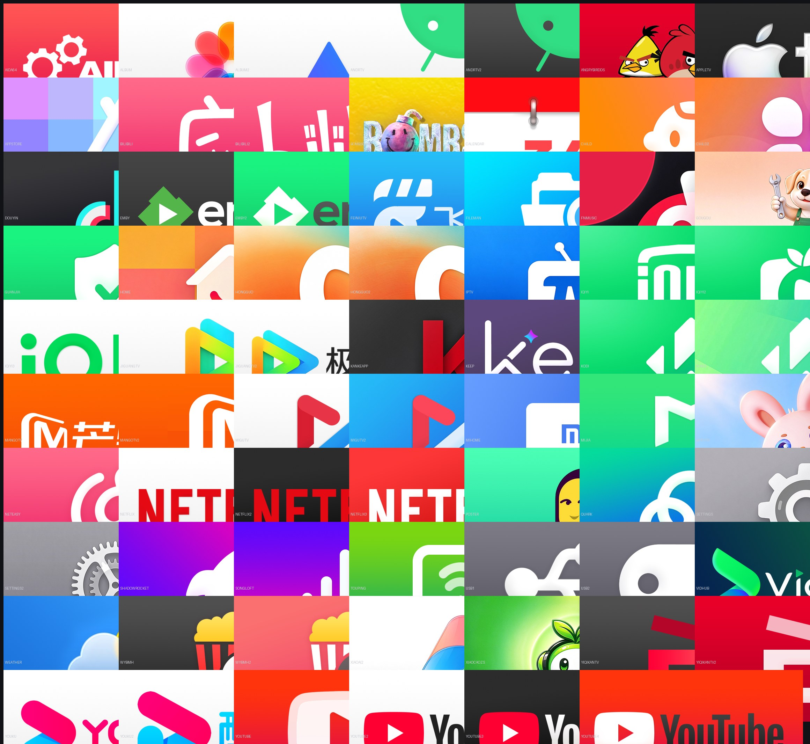

# 磁贴图（自制）

给 Aerial 桌面应用磁贴用的 16:9 图片，fork 作者手作，共 **69 张**，全部 **640×360 PNG**。命名即应用名缩写，末尾的 `2`/`3`/`4` 是同一应用的不同配色或构图变体，挑顺眼的用。

收录的应用（文件名即应用名缩写）：AIDA64、Android TV、Apple TV、B 站、BombSquad、Emby、IPTV、Keep、Kodi、Netflix、VidHub、YouTube、夸克、爱奇艺、优酷、芒果 TV、咪咕、腾讯极光、抖音、红果、网易云音乐、网易爆米花、米家、米兔、小爱、飞牛 TV/音乐、儿童模式、文件管理、日历、天气、设置、投屏、U 盘、管家、相册、桌面……其余见上方预览图。

## 怎么用

- **手机设置页上传**（推荐）：在电视控制中心扫「手机设置」二维码打开手机页，给对应应用上传这张图。App 会按磁贴的 16:9 裁切并按包名记住，优先级最高（覆盖应用自带图标与图标库）。
- **自建图标库**：`IconLibrary` 读 `<站点>/index.json`，格式 `{"icons": {"<包名>": "<相对路径>"}}`，把文件名对应到包名后即可多台电视共用。

## 许可与商标

- 图片本身按本仓库的 **MIT** 许可提供（见仓库根目录 `LICENSE`），可随意使用、修改、再分发。
- 图中出现的应用名称、标志与品牌归**各自权利人所有**。这些图仅用于在桌面上识别对应应用，本项目与权利人无隶属或背书关系；如你是权利人并要求移除，请开 issue。
